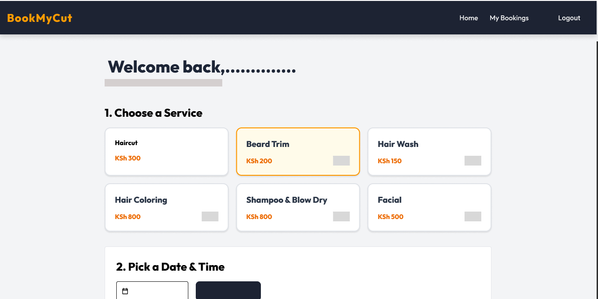
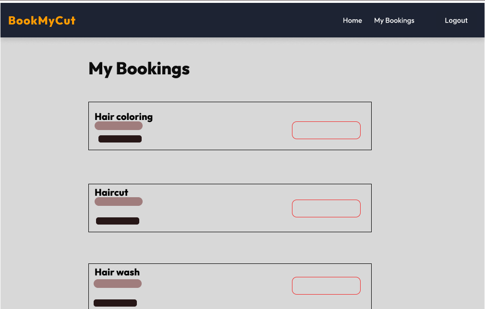
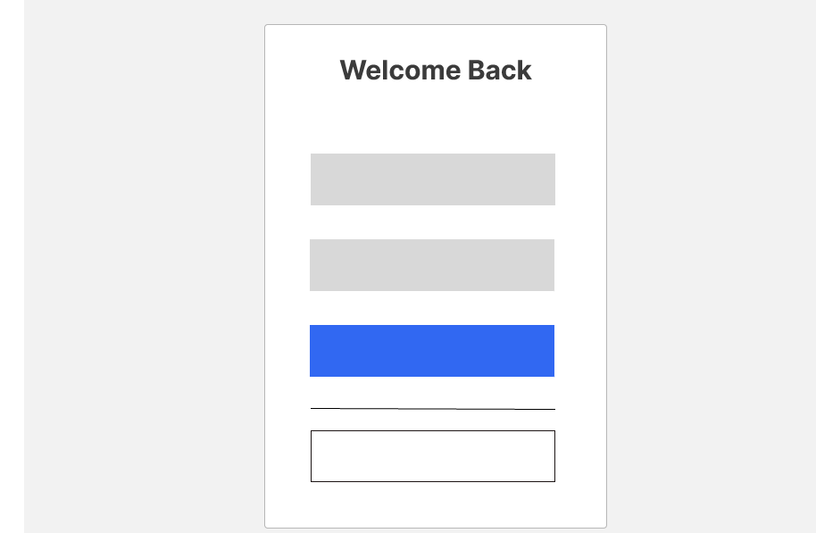

#  BookMyCut

BookMyCut is a modern salon and barbershop booking application. It allows customers to book appointments online, while salon owners can view their daily schedules in one place.

##  Project Links
*   Live Deployment: [book-my-cut-blush.vercel.app](https://book-my-cut-blush.vercel.app)
*   Figma Wireframe: [View the wireframe](https://www.figma.com/proto/wpcZNFSaYHUVYCVyJdJkxH/Untitled?node-id=0-1&t=NZBxnDq8YQr96Ne8-1)
*   GitHub Repository: [waleedabdi/BookMyCut](https://github.com/waleedabdi/BookMyCut)

## Screenshots

### 1. Login & Authentication

### 2. Booking Page & Holiday API

(Users select a service, pick a date, and see available time slots. The app fetches Kenyan Public Holidays to prevent booking on closed days).

### 3. My Bookings & Owner Dashboard

(Customers can view and cancel their bookings)

##  Key Features

* Register, log in and log out with email and password
* Sign in with Google
* Protected routes: pages for logged-in users redirect to the login page when you are signed out
* Choose from six services, each with a price and duration
* Pick a date and check which time slots are still available
* Book an appointment (the server checks your Firebase login token before saving)
* Upcoming public holidays are shown, and booking on a holiday is blocked
* Responsive layout for phones, tablets and desktops

##  Tech Stack
*   **Frontend:** React (Vite), Tailwind CSS, React Router
*   **Backend API:** Node.js, Express.js
*   **Database & Auth:** Firebase, Firestore
*   **External API:** Nager.Date (Public Holidays)

## How to Run Locally

1. **Clone the repository:**
   ```bash
   git clone https://github.com/waleedabdi/BookMyCut.git
   cd BookMyCut
   npm install
   ```
2. Create `.env.local` with the `VITE_FIREBASE_*` web configuration variables.
3. Keep the Firebase Admin service-account JSON in `src/server/serviceAccountKey.json` (local only; do not commit it).
4. Start the frontend and API together:
   ```bash
   npm run dev
   ```

## Vercel Deployment

The Vercel deployment serves the frontend and the API routes under `/api`. Set
the `VITE_FIREBASE_*` web configuration variables in the Vercel project
environment. Also add `FIREBASE_SERVICE_ACCOUNT` with the complete Firebase
Admin service-account JSON as a private environment variable. Redeploy after
changing environment variables. Never commit the service-account JSON.